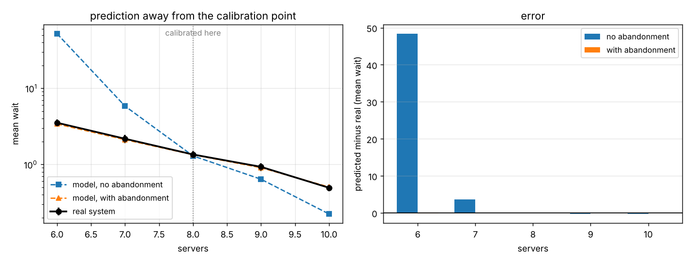

# Queue model calibration

## What this is about

If you build a simulation of an operation you are running, the normal way to
show it works is to tune it until its output matches what the real operation
did. Once it matches, the model is signed off and then used for the thing you
actually wanted it for, which is almost never reproducing the past. It is
answering what would happen if you changed something.

Those are different jobs. Matching history is interpolation inside a regime you
already observed. Predicting a change is extrapolation out of it. I wanted to
know how much the first one tells you about the second, because in practice the
first is treated as the licence to do the second.

So I set up a queue I control completely, built two models of it that are both
wrong in different ways, calibrated both until they reproduced the same measured
history, and then asked them a question neither had been fitted to.

## Where the data comes from

There is no external data. Everything is generated by the code here with fixed
seeds, so `python -m src.experiment` reproduces every number below.

The system is a multi-server queue with customers arriving at a rate that rises
and falls across a working day, service times with a long right tail, and
customers who give up and leave if they have waited longer than their patience.
That last part matters more than it sounds and is the whole point of what
follows. Service averages 6.0 time units with a coefficient of variation of 1.8,
patience averages 12.0, and arrivals run between 1.0 and 1.6 per unit time. At
the baseline of 8 servers that is about 97 per cent utilisation, which is busier
than anyone would plan for but not unusual to find.

I did it this way because I need to know the true answer. On a real operation I
could compare two models to each other but I could not say which was closer to
the truth, and that is the only question here.

## The question

If two models reproduce the same measured history equally well, does that tell
you they will agree about what happens when you change the staffing?

## How it works

One discrete-event engine runs everything. Events sit in a heap, and the system
and both models go through the same code with different distributions handed to
them, so nothing that differs between them comes from two separate pieces of
code behaving differently. An abandonment event for someone who has already
started service is left in the heap and ignored when it surfaces, which is
cheaper than finding and removing it.

The two models:

- **Model A** has exponential service times and nobody ever abandons. This is
  the textbook simplification and it is what you get if you model the queue from
  the staffing and the average handling time, which is the common case.
- **Model B** has exponential service times and keeps abandonment. It is still
  wrong about the shape of the service distribution, so it is not the truth
  wearing a disguise. The one thing it adds over A is the mechanism by which an
  overloaded queue relieves itself.

Each model has exactly one free parameter, an effective mean service time. I
bisect on it until the model reproduces the mean wait measured on the real
system at 8 servers. Then I run everything at 6, 7, 8, 9 and 10 servers, with 8
replications each, and compare.

Calibration and evaluation use the same run length and the same number of
replications but different seeds, so a model is never scored on the draws it was
fitted to. An earlier version of this had the calibration using shorter runs
than the evaluation, and the bad model came out mismatched even at the point it
had been fitted to, because it had partly been fitted to Monte Carlo noise. That
was my mistake rather than a finding, and fixing it made the real result
cleaner.

There are 24 tests. The ones I care about are the hand-checked cases: three
arrivals at times 0, 1 and 2 into a single server with service time 3 have to
produce waits of exactly 0, 2 and 4, and a customer with patience 2 behind a
server busy until time 10 has to abandon at exactly 2.

## What happened



The real system at 8 servers has a mean wait of 1.347. True mean service time is
6.00. After calibration:

| model | fitted effective service time | error against truth |
|---|---|---|
| no abandonment | 4.623 | -22.9% |
| with abandonment | 5.980 | -0.3% |

Model A had to be told that service takes 23 per cent less time than it does.
Nothing in the calibration flagged this. The missing mechanism did not show up
as a bad fit, it showed up as a plausible-looking number in a parameter that has
a physical meaning and was wrong.

Both models then reproduce the baseline out of sample, which is the thing a
sign-off would check:

| servers | real | model A, no abandonment | model B, with abandonment |
|---|---|---|---|
| 6 | 3.52 | 51.89 | 3.39 |
| 7 | 2.17 | 5.82 | 2.11 |
| **8** | **1.35** | **1.29** | **1.34** |
| 9 | 0.93 | 0.64 | 0.90 |
| 10 | 0.49 | 0.22 | 0.50 |

At the calibration point the two models are indistinguishable and both are
right. One server either side, they are not. Mean absolute error away from the
calibration point is 13.15 for model A and 0.06 for model B, a factor of about
220.

The failure is not symmetric and it is worst where it costs most. Asked what
happens if you drop from 8 servers to 6, model A predicts a mean wait of 51.89
against a real 3.52. It is wrong by a factor of nearly 15, and wrong in the
direction that would stop you making a change that would actually have been
survivable. It overshoots because without abandonment nothing relieves the
queue, so as utilisation approaches one the wait runs away. The real queue does
not run away, because people leave. Abandonment is a safety valve, and a model
without one does not just lose some accuracy, it loses the mechanism that
determines the answer under load.

## Limitations

One system, one baseline, one calibration target. The size of the effect
obviously depends on how close to saturation the baseline sits, and at 97 per
cent utilisation I have chosen a regime where a missing safety valve matters a
great deal. At 70 per cent I would expect the two models to stay much closer and
the whole thing to look less dramatic. I have not mapped that out.

I calibrated against the mean wait alone. Had I calibrated against the mean and
the 95th percentile together, model A would have struggled to match both at
once, and the mismatch would have been visible before any prediction was made.
That is worth knowing and is probably the practical lesson, but it means my
headline result is partly a statement about a weak calibration target rather
than only about a missing mechanism.

Both models are handed the true arrival process. In reality that is estimated
too, and errors there would interact with everything above.

FIFO with a single customer type, no priorities, no reneging back into the
queue, no shift structure or breaks. Real operations have all of these.

The baseline wait is measured with a standard deviation of 0.16 across
replications, so the calibration target itself carries roughly 12 per cent
uncertainty, and the fitted parameters inherit it.

## What I take from it

Matching history did not distinguish an adequate model from an inadequate one.
Both models hit the baseline, and one of them was then wrong by a factor of
fifteen about the only question anyone would ask it.

What calibration did instead was conceal the inadequacy. The missing mechanism
was absorbed into a 23 per cent error in a parameter with a physical meaning,
and in that form it is invisible, because a service time of 4.6 does not look
like anything. It looks like a number. If I had not known the true value I would
have had no reason to doubt it.

The thing that separated the two models was never going to come from a better
fit. It came from asking both of them about a regime neither had been fitted to,
and the only reason I could score that was that I had built the system myself and
knew the answer. On a real operation that check is not available, which is the
part I find uncomfortable and do not have an answer to.

## Running it

```
pip install -r requirements.txt
python -m src.experiment     # about 11 seconds, writes results.json and figures/
python -m pytest tests/ -q   # 24 tests, under 2 seconds
```
